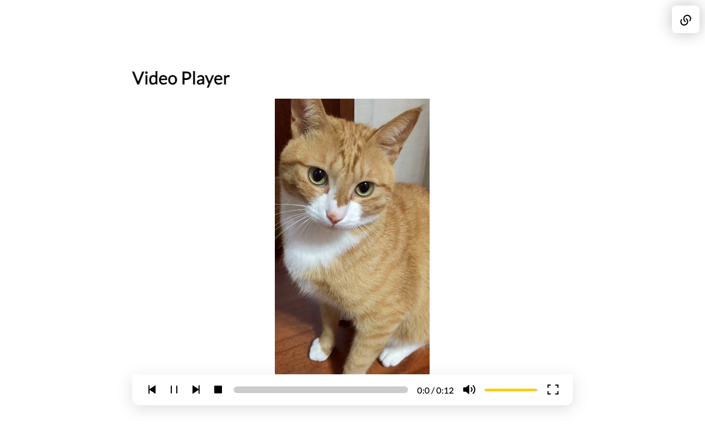

# Video Player

GitHub(조직): https://github.com/2026-2-OSS/assign10-c01-22300378.git
GitHub(개인): https://github.com/ggm77/2026OSS_assign10.git
Vercel: https://2026-oss-assign10-seven.vercel.app/

## Project Information

### 프로젝트 소개
비디오 플레이어 프로젝트입니다. 재생, 정지, 볼륨 조절, 음소거, 전체 화면, 남은 시간 표시, 이전/다음 영상 이동 기능이 있고, 사용자가 직접 영상 URL을 입력해서 재생할 수도 있습니다.

### 선정 이유
영상을 스트리밍하고 조작하는 프로젝트에 관심을 가지고 있어서 기본적인 영상 스트리밍을 제공하는 이 프로젝트를 선정하게 되었습니다.

### 주요 기능
data.js에 저장된 영상 URL을 통해 받은 영상을 스트리밍합니다. 또는 사용자에게 직접 URL을 받아 영상을 재생합니다.

### 원본 프로젝트
- 원본 GitHub URL: https://github.com/sahilatahar/Video-Player
- 원작자: Sahil Atahar

### 라이선스
원본 프로젝트는 [MIT License](LICENSE)를 따릅니다.

## Installation

### 설치 및 실행 방법
```bash
git clone https://github.com/ggm77/2026OSS_assign10.git
cd 2026OSS_assign10
npm install
npm run dev
```
실행 후 브라우저에서 `http://localhost:5173` 으로 접속하면 된다.

### 실행 화면


## Source Code Exploration

### Project Structure
- **VideoPlayer.jsx**: URL로 받은 비디오를 재생시키는 컴포넌트이다. 영상 재생, 볼륨 조절, 영상 재생 위치등의 정보를 조작하는 역할을 한다.
- **Context.jsx**: data.js 파일에 저장된 영상의 정보를 전역 변수로서 사용할 수 있게 컴포넌트 형태로 만들어주는 파일.
- **Popup.jsx**: 특정 영상의 URL을 사용자에게 받아서 재생할 때 영상의 URL을 검증하고 팝업을 띄워주는 파일.

### React Component
- **App**: 메인 화면 컴포넌트이다. 팝업 버튼, Popup, VideoPlayer를 화면에 보여준다.
- **ContextProvider**: `videoList`(영상 목록)와 `currentVideoSrc`(현재 영상)를 state로 가지고 있고, Context를 통해 하위 컴포넌트에서 쓸 수 있게 해준다.
- **VideoPlayer**: Context 컴포넌트를 통해 받아온 비디오 URL을 플레이리스트로써 사용하고, video 태그를 통해 실제 영상을 재생시킨다.
- **Popup**: 사용자가 입력한 URL이 영상인지 확인하고, 맞으면 영상 목록에 추가하고 바로 재생한다.

### Code Analysis
```js
 // Make a HEAD request to check Content-Type header
try {
    const response = await fetch(url, { method: 'HEAD' });
    if (response.ok) {
        const contentType = response.headers.get('content-type');
        if (contentType && contentType.startsWith('video/')) {
            return true;
        }
    }
} catch (error) {
    // Handle fetch error
    console.error('Error checking URL:', error);
}
return false;
```
Popup.jsx 파일에서 사용자에게 입력받은 URL이 정상적인지 확인하는 코드이다. 입력 받은 URL에 HEAD 요청을 보내 응답 값이 어떤 유형인지 판단하여 올바른 URL인지 확인한다. 응답의 헤더 정보 중에 content-type을 확인하여 비디오 파일인 경우에만 올바른 URL이라고 판단한다. 단, CORS에러가 발생 할 수 있다.


## Customizing

### 1. 메인 화면에 제목 추가 (Text)
- 수정 파일: `src/App.jsx`

```js
// Before
return (
<div className="App">
    {!isPopup && <button className="popup-btn" onClick={() => setIsPopup(true)}><i className="ri-links-line"></i></button>}

    {isPopup && <Popup {...{ setVideoList, setCurrentVideoSrc, setIsPopup }} />}
    <VideoPlayer />
</div>
)
```
``` js
// After
return (
<div className="App">
    {!isPopup && <button className="popup-btn" onClick={() => setIsPopup(true)}><i className="ri-links-line"></i></button>}

    {isPopup && <Popup {...{ setVideoList, setCurrentVideoSrc, setIsPopup }} />}
    <div style={{ display: "flex", flexDirection: "column" }}>
    <h1>Video Player</h1>
    <br></br>
    <VideoPlayer />
    </div>
</div>
)
```
기존 메인 화면에서 비디오 플레이어만 띄우다가 비디오 플레이어라는 제목을 붙였습니다.


### 2. 영상 최대 높이 설정 (Style)
- 수정 파일: `src/VideoPlayer/VideoPlayer.jsx`

```html
<!-- Before -->
<video ref={videoRef} src={currentVideoSrc} onClick={handlePlayPause} >
```
```html
<!-- After -->
<video ref={videoRef} src={currentVideoSrc} onClick={handlePlayPause} style={{maxHeight: "500px"}}>
```
기존에는 영상을 원본 크기로 화면에 그대로 그려서 고해상도의 영상은 화면에 다 들어가지 않는 문제가 있었다. 최대 높이를 설정하여 해결하였다.


### 3. 기본 영상 URL 교체 (Data)
- 수정 파일: `src/Data/data.js`

```js
// Before
const videosURLs = [
    "https://storage.googleapis.com/gtv-videos-bucket/sample/BigBuckBunny.mp4",
    "https://storage.googleapis.com/gtv-videos-bucket/sample/ElephantsDream.mp4",
    "https://storage.googleapis.com/gtv-videos-bucket/sample/ForBiggerBlazes.mp4",
    "https://storage.googleapis.com/gtv-videos-bucket/sample/ForBiggerEscapes.mp4",
    "https://storage.googleapis.com/gtv-videos-bucket/sample/ForBiggerFun.mp4",
    "https://storage.googleapis.com/gtv-videos-bucket/sample/ForBiggerJoyrides.mp4",
    "https://storage.googleapis.com/gtv-videos-bucket/sample/ForBiggerMeltdowns.mp4",
    "https://storage.googleapis.com/gtv-videos-bucket/sample/SubaruOutbackOnStreetAndDirt.mp4",
    "https://storage.googleapis.com/gtv-videos-bucket/sample/TearsOfSteel.mp4"
]
```
``` js
// After
const videosURLs = [
    "https://fshs.seohamin.com/api/v2/auth/files/3e46053fbb044cef9b60f661317f4d5c/content?download=false",
    "https://fshs.seohamin.com/api/v2/auth/files/9be610e435f94a7895486d0e4bc226b8/content?download=false"
]
```
기본적으로 재생할 영상의 URL을 교체함. 기존에는 인증에 막혀 영상이 재생되지 않았지만, 이를 해결함.

### 4. 영상 URL 검증 방식 변경 (Logic)
- 수정 파일: `src/components/Popup/Popup.jsx`

```js
// Before
async function validateVideoUrl(url) {
        const videoExtensions = ['.mp4', '.webm', '.avi', '.mov']; // List of common video extensions

        // Check if the URL ends with a valid video extension
        const urlLower = url.toLowerCase();
        if (videoExtensions.some(ext => urlLower.endsWith(ext))) {
            return true;
        }

        // Make a HEAD request to check Content-Type header
        try {
            const response = await fetch(url, { method: 'HEAD' });
            if (response.ok) {
                const contentType = response.headers.get('content-type');
                if (contentType && contentType.startsWith('video/')) {
                    return true;
                }
            }
        } catch (error) {
            // Handle fetch error
            console.error('Error checking URL:', error);
        }
        return false;
    }
```

```js
// After
function validateVideoUrl(url) {
    return new Promise(resolve => {
        const video = document.createElement('video');
        video.preload = 'metadata';
        video.onloadedmetadata = () => resolve(true);
        video.onerror = () => resolve(false);
        video.src = url;
    });
}
```
기존에는 영상 URL이 정상인지 조회 할 때 영상 URL로 fetch를 날려서 검사했었습니다. 이는 CORS에 걸리기 쉽지만 영상을 재생 할 때는 CORS가 상관 없기 때문에 URL검사를 실제 비디오 태그에 넣는 방식으로 변경하였습니다.


## Deployment

- 배포 URL: https://2026-oss-assign10-seven.vercel.app/


## Weekly Review

### 새롭게 배운 내용 3가지
1. **React Context**: props를 여러 단계로 넘기지 않고 `createContext`와 `useContext`로 영상 목록 같은 데이터를 여러 컴포넌트에서 같이 쓸 수 있다는 것을 알게 되었다.
2. **CORS**: fetch로 다른 도메인에 요청을 보내면 서버가 허락하지 않는 경우 브라우저가 막는다는 것을 배웠다. 반면에 `<video>` 태그로 영상을 불러오는 것은 CORS 제한을 받지 않는다는 것도 알게 되었다.
3. **useRef**: `useRef`로 video 태그 같은 DOM 요소에 직접 접근해서 `play()`, `pause()`를 호출할 수 있고, 화면을 다시 그리지 않아도 되는 값(현재 영상 번호)을 저장하는 데에도 쓸 수 있다는 것을 배웠다.

### 어려웠던 점과 해결 방법
- **URL 검증에서 CORS 에러**: 정상적인 영상 URL을 넣어도 "올바르지 않은 URL"이라고 나오는 경우가 있었다. 개발자 도구 콘솔을 보니 HEAD 요청이 CORS 에러로 막히고 있었다. 그래서 fetch 대신 video 태그를 만들어서 메타데이터가 불러와지는지로 검사하도록 바꿔서 해결했다.
- **기본 영상이 재생되지 않음**: 원본 프로젝트의 영상 URL이 인증에 막혀서 재생이 안 됐다. 직접 접근 가능한 영상 URL로 교체해서 해결했다.
- **고해상도 영상이 화면을 넘어감**: 영상이 원본 크기로 나와서 화면에 다 안 들어갔다. video 태그에 `maxHeight`를 설정해서 해결했다.

### AI 활용 내용 및 느낀 점
- 처음 보는 코드라서 각 파일과 컴포넌트가 어떤 역할을 하는지 AI에게 물어보면서 구조를 파악했다.
- CORS 에러가 났을 때 원인과 다른 검증 방법을 AI에게 물어봤고, video 태그를 이용하는 방법을 참고해서 적용했다.


## License

This project is licensed under the [MIT License](LICENSE), which means you are free to use, modify, and distribute the code as you see fit.
